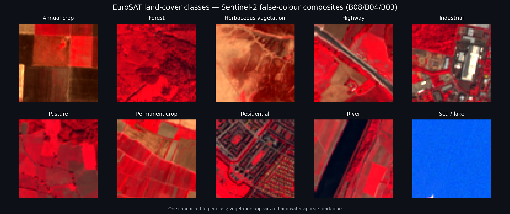
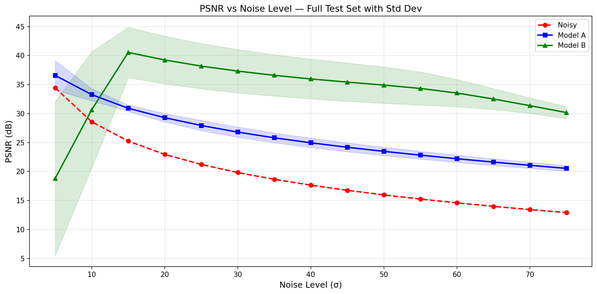
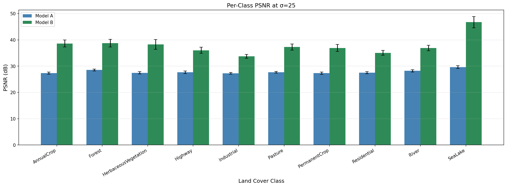

# EuroSAT multispectral image denoising

This project tests a specific question: **does a denoiser benefit from seeing all 13 Sentinel-2 bands together, or is one shared band-wise model more effective?** Two residual DnCNN models are trained on the same EuroSAT tiles and Gaussian-noise regime, then compared across noise levels, land-cover classes, and spectral bands.

The result is not a simple win for the larger input. The shared single-band model is dramatically better from `σ=15` through `σ=75`, while the 13-band model is much more reliable at very low noise. At `σ=5`, the band-wise model is unstable enough to damage otherwise clean inputs. The repository includes the trained weights, full evaluation report, plots, and the notebook that produced them.



The preview uses one canonical tile from each class. Sentinel-2 bands B08/B04/B03 are mapped to RGB, so healthy vegetation appears red and water appears dark blue. The image is generated directly from the multispectral archive by `scripts/create_sample_grid.py`; it is not a stock illustration.

## What is being compared

Both models use the same 17-layer DnCNN backbone and learn residual noise: the network predicts the corruption and the clean estimate is `noisy - predicted_noise`.

| | Model A: joint multispectral | Model B: shared band-wise |
|---|---:|---:|
| Input/output channels | 13 / 13 | 1 / 1 |
| How it is applied | One pass over the full tile | Same network applied independently to all 13 bands |
| Trainable parameters | 570,893 | 557,057 |
| Intended advantage | Learn spatial and cross-band relationships | Pool training examples across bands without coupling their distributions |

Model B does **not** train 13 separate networks. Every band uses the same one-channel weights. This turns each 13-band image into 13 training examples and imposes a strong shared-denoising prior.

## Data and preprocessing

Each sample is a `64 × 64` GeoTIFF with all 13 Sentinel-2 bands. Reflectance values are divided by 10,000 and clipped to `[0, 1]`. Additive white Gaussian noise is generated on that normalized tensor, with `σ` expressed on the conventional 0–255 image scale.

The supplied experiment archive contains **27,597 images**:

| Class | Images | Class | Images |
|---|---:|---|---:|
| AnnualCrop | 3,000 | Pasture | 2,000 |
| Forest | 3,000 | PermanentCrop | 2,500 |
| HerbaceousVegetation | 3,000 | Residential | 3,000 |
| Highway | 2,500 | River | 2,500 |
| Industrial | 2,500 | SeaLake | 3,597 |

The standard EuroSAT portion accounts for 27,000 class-prefixed tiles. The local archive also contains 597 supplemental water scenes under `SeaLake` (512 `Jakarta_*` and 85 `Bombay_*` files). Those scenes are included by default because the committed checkpoints and results were produced from the full 27,597-image corpus. Set `INCLUDE_SUPPLEMENTAL_WATER_SCENES = False` in the notebook to select only the 27,000 class-prefixed tiles; doing so defines a different training corpus and requires retraining for a fair comparison.

The split is class-stratified and deterministic (`seed=42`):

- train: 19,317 images (70%)
- validation: 2,760 images (10%)
- test: 5,520 images (20%)

## Training protocol

| Setting | Value |
|---|---|
| Architecture | DnCNN, 17 convolutional layers, 64 features |
| Training corruption | Random `σ ~ Uniform(10, 55)` per sample |
| Objective | Mean squared error between denoised and clean tensors |
| Optimizer | Adam, learning rate `1e-3` |
| Batch size | 128 |
| Validation noise | `σ=25` |
| Scheduler | ReduceLROnPlateau, factor 0.1, patience 5 |
| Maximum epochs | 150 |
| Early stopping | 10 validation epochs without improvement |

PSNR measures reconstruction error in decibels; higher is better. SSIM measures structural similarity on `[0, 1]`; higher is better. The detailed evaluation sweeps 15 fixed noise levels (`σ=5…75`) and also reports results by class and, for Model B, by spectral band.

## Results

Selected rows from the complete 5,520-image test-set sweep are shown below. Values after `±` are the standard deviation of per-image PSNR.

| σ | Noisy PSNR | Model A PSNR | Model B PSNR | Model A SSIM | Model B SSIM |
|---:|---:|---:|---:|---:|---:|
| 5 | 34.434 | **36.576 ± 2.542** | 18.807 ± 13.255 | **0.8645** | 0.7423 |
| 10 | 28.570 | **33.258 ± 1.054** | 30.650 ± 10.006 | 0.7512 | **0.9264** |
| 15 | 25.244 | 30.908 ± 0.533 | **40.540 ± 4.342** | 0.6820 | **0.9466** |
| 25 | 21.217 | 27.936 ± 0.880 | **38.178 ± 3.907** | 0.6079 | **0.9185** |
| 50 | 15.961 | 23.473 ± 0.719 | **34.908 ± 3.137** | 0.4828 | **0.8677** |
| 75 | 12.914 | 20.535 ± 0.479 | **30.167 ± 1.031** | 0.3851 | **0.7679** |



The main findings are:

- **Model B dominates in the trained noise regime.** It leads Model A by 9.632 dB at `σ=15`, 10.242 dB at `σ=25`, and 11.435 dB at `σ=50`.
- **The advantage is not confined to one land-cover type.** Model B wins all ten classes at both `σ=25` and `σ=50`. At `σ=25`, its class means range from 33.720 dB on Industrial scenes to 46.731 dB on SeaLake scenes.
- **The very-low-noise behavior is a real failure mode.** At `σ=5`, Model B falls 15.627 dB below the noisy input, with a 13.255 dB standard deviation. Model A instead improves the input by 2.142 dB. The network trained across `σ=10…55` has not learned an identity-like response below that range.
- **The difference is statistically consistent in the main evaluation regime.** Paired tests at `σ=15`, `25`, and `50` reject equal mean PSNR at the 0.05 level. The report retains the underlying t-statistics and printed p-values.
- **Band difficulty varies substantially.** For Model B at `σ=25`, mean per-band PSNR ranges from 34.054 dB (Band 8) to 53.097 dB (Band 10), showing why one aggregate metric is not enough for multispectral imagery.



The complete numerical output is in [`results/evaluation_results.txt`](results/evaluation_results.txt). The remaining figures cover SSIM, per-channel behavior, and the PSNR gap between the models.

## Reproducing the workflow

Python 3.10 or newer is recommended. A CUDA-capable GPU is strongly recommended for training and for the full 82,800-case sweep, but checkpoint loading and smaller evaluations also work on CPU.

```bash
python3 -m venv .venv
source .venv/bin/activate
pip install -r requirements.txt
cp .env.example .env
```

Obtain the EuroSAT all-bands GeoTIFF data, extract it outside Git, and set `DATASET_PATH` in `.env` to the directory that directly contains the ten class folders:

```text
data/eurosat-dataset/EuroSATallBands/
├── AnnualCrop/
├── Forest/
├── HerbaceousVegetation/
├── Highway/
├── Industrial/
├── Pasture/
├── PermanentCrop/
├── Residential/
├── River/
└── SeaLake/
```

Then start Jupyter and run [`eurosat_multispectral_denoising.ipynb`](eurosat_multispectral_denoising.ipynb) from top to bottom:

```bash
jupyter lab eurosat_multispectral_denoising.ipynb
```

The safe defaults load the supplied weights and skip retraining. They also leave the expensive detailed sweep disabled. Change only the switches needed for a run:

```python
TRAIN_MODEL_A = False
TRAIN_MODEL_B = False
RUN_DETAILED_EVALUATION = False
```

Fresh plots are written to `outputs/`. Training writes best weights and resumable checkpoints to `MODEL_DIR`; intermediate checkpoints and datasets are intentionally ignored by Git.

To regenerate the README preview without extracting the TIFFs:

```bash
python scripts/create_sample_grid.py /path/to/eurosat-dataset.zip
```

## Repository map

```text
.
├── eurosat_multispectral_denoising.ipynb  # complete experiment workflow
├── models/
│   ├── best_model_a.pth                   # joint 13-band DnCNN
│   └── best_model_b.pth                   # shared single-band DnCNN
├── results/evaluation_results.txt         # full numeric evaluation report
├── assets/
│   ├── eurosat_sample_grid.png            # data-derived README preview
│   └── results/                            # five evaluation figures
├── scripts/create_sample_grid.py           # reproducible preview generator
├── tests/test_project_artifacts.py         # notebook/checkpoint/artifact checks
├── .env.example
└── requirements.txt
```

Run the fast integrity suite with:

```bash
python -m unittest discover -s tests -v
```

## Limitations

- The corruption model is synthetic white Gaussian noise, not a calibrated Sentinel-2 sensor-noise model.
- The split is stratified by class but not by geographic region; nearby tiles may occur in different partitions.
- Reflectance is divided by 10,000 and clipped uniformly rather than normalized according to the physical range of each band.
- The low-noise failure of Model B makes it unsuitable as an unconditional denoiser without a noise estimator, a lower-σ training curriculum, or a bypass rule.
- The per-channel analysis uses the first 1,000 deterministic test paths, while the main sweep and per-class analysis use all 5,520 test images.
- The committed results correspond specifically to the 27,597-tile corpus and seed described above. Changing the corpus, split, or random process requires reporting a new run.

## Dataset reference

EuroSAT was introduced by Patrick Helber, Benjamin Bischke, Andreas Dengel, and Damian Borth in *EuroSAT: A Novel Dataset and Deep Learning Benchmark for Land Use and Land Cover Classification* (IEEE JSTARS, 2019). The dataset and original project details are available from the [EuroSAT project repository](https://github.com/phelber/EuroSAT) and the paper at [DOI 10.1109/JSTARS.2019.2918242](https://doi.org/10.1109/JSTARS.2019.2918242).
